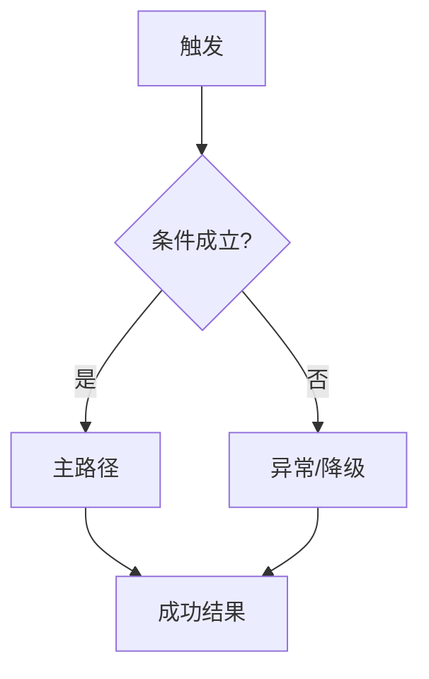

# PRD 编写规范

> 来源：个人产品经理工作台沉淀 + 团队实践。不照抄外部 Agent 规范。

## 核心原则

简单、清晰、可执行、可验证。

PRD 的目标不是穷举一切可能，而是让产品、设计、研发、测试快速理解需求，并按一致规则执行。

---

## 五步写法

### 第1步：先定义目标和范围

写清楚：用户为什么需要、要解决什么问题、本期做什么、不做什么。

**完成标准：** 能用几句话解释本次需求的目的和边界。

### 第2步：先画流程，再写规则

先梳理：触发条件 → 处理过程 → 成功结果 → 失败分支。先确认主流程，再补异常。

**完成标准：** 关键节点、状态变化和分支都有明确去向。

#### 流程图怎么写（Star PM / PRD 壳）

流程卡片、决策与异常分支，优先用 **Mermaid 文本**，不要贴位图。

1. 在 PRD（Markdown / HTML 壳）里放 fenced 代码块，语言标 `mermaid`。  
2. PRD 壳会页内渲染；可点图改源码再同步。  
3. **Agent / MCP 约定：** 输出或写入 ` ```mermaid ` … ` ``` ` 即可自动解析展示；**不需要**「传流程图图片」的 MCP。  
4. 决策节点用菱形（`{条件?}`），异常用单独分支写清去向。



本期不做：位图 OCR 矢量化、专用「传图」MCP（糊、难 diff、难改）。

### 第3步：建立规则清单

把关键规则、权限、边界条件、异常处理、待确认问题列出来。不要边写长篇 PRD 边临时发明规则。

**完成标准：** 每项关键规则都有明确结论，或标记为「待确认」。

### 第4步：最后才写完整 PRD

把已确定的规则转成：需求描述、交互说明、状态说明、验收标准。

**完成标准：** 研发能理解如何实现，测试能据此判断对错。

### 第5步：集中审查，确认后冻结

一次性检查歧义、遗漏、矛盾；汇总需领导确认的决策，再集中评审。

**完成标准：** 关键问题已解决；剩余问题有负责人与处理计划；不再因小细节反复重写整份文档。

---

## PRD 提交前检查（5/5）

- [ ] 需求目标和本期范围明确
- [ ] 主流程、关键状态和异常分支完整
- [ ] 重要规则没有歧义或相互矛盾
- [ ] 待确认事项已明确标记，没有擅自假设
- [ ] 验收标准能够判断结果是否正确

---

## 编写规则

### 1. 先明确问题，再定义方案

分清三层，不要混写：

- **问题背景：** 当前存在什么问题？
- **需求目标：** 本次要解决什么？
- **解决方案：** 具体怎么调整？

### 2. 规则尽量简洁

- 一条规则表达一个明确要求
- 用直接、具体的语言，避免模糊表达
- 优先用表格、列表、短示例
- 不重复已明确内容，不为显得专业堆术语

### 3. 只定义必要的规则

- 优先解决当前核心问题
- 区分本期必须 vs 后续优化
- 不必穷举所有边界；影响核心流程、数据安全、权限、结果正确性的要重点写
- 未定规则标「待确认」，不要擅自假设

### 4. 规则必须可执行、可验证

避免「优化体验」「正确展示」「确保正常运行」。尽量写清：

- 什么条件下触发？
- 系统执行什么行为？
- 用户最终看到什么？
- 怎样判断实现正确？

### 5. 测试 Case 与规则对应

至少包含：输入/前置条件 → 执行操作 → 预期结果。

优先覆盖：正常流程、明显无效输入、核心异常。不必把每条规则扩成大量重复用例。

### 6. 控制需求范围

写完后逐条检查新增规则：是否解决当前问题？是否影响本期核心目标？是否必须现在实现？是否可记为后续优化？没有明确价值就不要加。

---

## 推荐文档结构（按复杂度选）

**简单需求：**

1. 问题背景
2. 规则说明
3. 测试 Case（必要时）

**复杂需求：**

1. 需求背景与目标
2. 功能范围（含本期不做）
3. 核心规则与交互流程
4. 异常处理及必要边界
5. 测试 Case 与验收标准

复杂需求如需页面级说明，可在「核心规则与交互流程」下按页面补充：用途、入口/退出、组件、操作逻辑、状态、异常、文案。不强制每份 PRD 都写满。

---

## 版本记录写法

版本表至少包含：版本号 | 日期 | 触发源头 | 修改内容

**触发源头示例：** 研发评审 / 测试疑问 / 原型同步 / 底层能力变化 / 领导决策 / 竞品对标 / 用户反馈

修改内容写清「因何而改」，不要只写「更新」。

---

## 交付成套与目录

每个正式需求尽量成套：

- PRD（Markdown）
- PC 原型（如有 PC）
- 移动原型（如有移动）

目录约定：

- **草稿箱：** 未评审、未冻结的草稿
- **正式目录：** 评审通过、可开发的成套交付

模块可用交付看板表：功能模块 | PRD | PC 原型 | 移动原型 | 是否完整交付

---

## 协作方式

- 先理解实际问题，不要直接扩写成大型 PRD
- 优先给简单、可执行的方案
- 关键规则缺失时提出必要问题
- 用户在练习独立拆解时，用追问引导，不代替全部分析
- 范围已确认时，不要反复推翻
- 输出前检查：重复、歧义、过度设计、无法验证的描述

**最终标准：** 团队用尽可能少的阅读成本，准确理解需求，并知道如何实现和验证。
