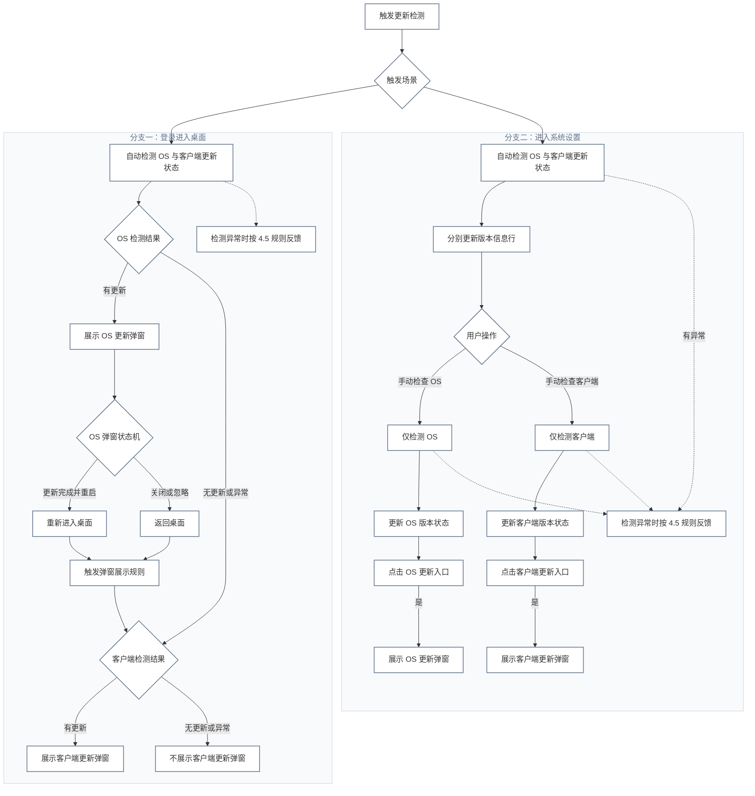

# 更新弹窗展示优先级 PRD V2.7

## 1. 版本记录

| 版本 | 日期       | 修改内容                                                                 |
| ------ | ------------ | -------------------------------------------------------------------------- |
| V2.6 | 2026-10-19 | 原版本                                                                   |
| V2.7 | 2026-10-20 | 基于 V2.6 调整检测及展示规则，统一术语；修正流程图、页面说明和验收标准。 |

## 2. 背景

MinisCloud OS 的 OS 更新与客户端更新分别具有独立的检测及更新流程，现有产品已具备对应的更新弹窗和系统设置中的版本状态展示功能。

当前用户登录进入桌面时，系统会自动检测 OS 与客户端的更新状态；进入系统设置页面时，也会自动检测并更新版本状态。用户还可以在系统设置页面手动检查指定项目的更新情况。

由于 OS 与客户端可能同时存在更新，需要明确桌面更新弹窗的展示优先级。同时，需要明确系统设置页面中自动检测、手动单项检查的结果反馈方式。

本文档基于现有更新功能，仅规范更新检测触发、检测结果反馈、OS 与客户端更新弹窗的展示优先级。原有更新弹窗内容、下载、安装及更新执行流程不在本次调整范围内。

## 3. 目标

1. 统一 OS 与客户端更新检测的触发方式、结果反馈及弹窗展示规则。
2. 明确桌面与系统设置页面的检测范围和反馈方式。
3. 明确 OS 与客户端均有更新时的弹窗展示优先级。
4. 统一异常（失败、超时）的处理口径，避免单项异常影响另一项已确认的更新。
5. 明确各检测场景、更新状态和展示结果，供研发实现与测试验收使用。

## 4. 规则定义

### 4.1 检测触发规则

**触发规则**

1. 用户登录进入桌面后，自动检测 OS 与客户端的更新状态。
2. 用户进入「设置」→「系统设置」后，自动检测 OS 与客户端的更新状态，并更新页面版本信息。
3. 用户在系统设置页面手动检查 OS 或客户端时，仅检测所选项目。

**具体表现见下表：**

| 触发场景                     | 检测范围                       | 反馈方式                                                             |
| ------------------------------ | -------------------------------- | ---------------------------------------------------------------------- |
| 登录进入桌面                 | 自动检测 OS 与客户端的更新状态 | 根据展示优先级规则展示更新弹窗，OS与客户端皆有更新时，优先展示OS弹窗 |
| 进入「设置」→「系统设置」   | 自动检测 OS 与客户端的更新状态 | 分别更新页面中 OS 与客户端的版本状态                                 |
| 在系统设置页面手动检测 OS    | 仅检测 OS                      | 更新 OS 对应的版本状态；点击更新时展示 OS 更新弹窗                   |
| 在系统设置页面手动检测客户端 | 仅检测客户端                   | 更新客户端对应的版本状态；点击更新时展示客户端更新弹窗               |

### 4.2 展示优先级规则

检测结果包括有更新、无更新和异常（失败、超时）。**检测结果对应展示：**

- 仅OS有更新：展示OS更新弹窗。
- 仅客户端有更新：展示客户端更新弹窗。
- OS和客户端均有更新：优先OS更新弹窗。
- 接口返回异常（失败、超时）时：按现有业务进行提示。

本规则适用于登录进入桌面后的自动更新检测。根据 OS 与客户端的检测结果决定更新弹窗的展示顺序；OS 弹窗结束后的后续展示按 4.3 执行。

**具体表现见下表：**

| OS检测结果         | 客户端检测结果     | 弹窗展示结果                                                                        |
| -------------------- | -------------------- | ------------------------------------------------------------------------------------- |
| 有更新             | 有更新             | 优先展示 OS 更新弹窗；OS 更新弹窗结束后，按 4.3 规则处理客户端更新弹窗              |
| 有更新             | 无更新             | 只展示 OS 更新弹窗                                                                  |
| 有更新             | 异常（失败、超时） | 只展示 OS 更新弹窗                                                                  |
| 无更新             | 有更新             | 只展示客户端更新弹窗                                                                |
| 异常（失败、超时） | 有更新             | 展示客户端更新弹窗，弹窗关闭或更新流程结束后，展示 OS 异常 Toast                    |
| 无更新             | 无更新             | 无更新弹窗                                                                          |
| 无更新             | 异常（失败、超时） | 无更新弹窗，按现有业务进行提示（弹窗关闭或更新流程结束后，展示 客户端 异常 Toast） |
| 异常（失败、超时） | 无更新             | 无更新弹窗，直接展示 OS 异常 Toast                                                  |
| 异常（失败、超时） | 异常（失败、超时） | 无更新弹窗，按现有业务进行提示                                                      |

### 4.3 弹窗展示规则

OS更新弹窗处理完成后，根据以下情况被动触发弹窗展示规则：

* **更新完成并重启：** 重新进入桌面后，触发展示规则。
* **关闭或忽略本次更新：** 返回桌面后，触发展示规则。

**OS 更新状态机**：

| OS 弹窗处理结果            | 触发条件                            | 状态转换后的处理                                                           |
| ---------------------------- | ------------------------------------- | ---------------------------------------------------------------------------- |
| 更新弹窗展示中 → 更新完成 | OS 更新完成，系统重启并重新进入桌面 | 触发弹窗展示规则；若客户端有更新，则展示客户端更新弹窗                     |
| 更新弹窗展示中 → 已关闭   | 用户关闭 OS 更新弹窗                | 返回桌面，触发弹窗展示规则；若客户端有更新，则展示客户端更新弹窗           |
| 更新弹窗展示中 → 已忽略   | 用户选择「忽略本次版本更新」        | 退出弹窗并返回桌面，触发弹窗展示规则；若客户端有更新，则展示客户端更新弹窗 |

### 4.4 展示流程

1. 登录进入桌面后，自动检测 OS 与客户端的更新状态。
2. OS 与客户端均有更新时，优先展示 OS 更新弹窗
3. 返回桌面后，触发展示优先级规则。

**更新检测与弹窗展示流程图：**

### 4.5 检测异常（失败、超时）反馈

根据检测结果，按以下规则处理异常结果：

1. **桌面自动检测：** 接口返回异常（失败、超时）项，不展示更新弹窗，不影响另一项已确认更新的正常展示；按现有业务toast进行提示，具体提示文案及展示样式沿用现有客户端规范。
2. **系统设置页面自动检测：** 接口返回异常（失败、超时）项，不展示更新弹窗，不影响另一项的状态更新；按现有业务toast进行提示，具体提示文案及展示样式沿用现有客户端规范。

   * **版本信息行文案展示：** 接口返回异常（失败、超时）项，对应版本信息行展示异常状态；具体文案沿用现有页面规范。

     | 检测结果                   | 版本信息行状态展示                                                                   |
     | ---------------------------- | -------------------------------------------------------------------------------------- |
     | 有更新                     | 展示对应项目的更新信息，沿用现有更新操作方式                                         |
     | 无更新                     | 「当前已是最新版本」                                                                 |
     | 接口返回异常（失败、超时） | 检测失败：「检查更新失败，请稍后重试」（如接口返回具体失败原因，则展示具体失败原因） |
3. **异常 Toast 展示规则：**（待确认）

   1. OS 与客户端检测结果独立处理，任一项目检测异常不影响另一项目的正常更新流程。
   2. 当存在更新弹窗时，异常 Toast 延后至更新弹窗及更新流程结束、返回桌面后展示，不打断正常更新流程。
   3. 同一轮检测中，OS 与客户端均异常时，合并展示一条 Toast：
      * 异常类型相同：统一提示对应异常类型。
      * 异常类型不同：分别说明 OS 与客户端的异常类型。
   4. 仅一项检测异常时，展示该项目对应的异常 Toast。

| OS 检测 | 客户端检测 | Toast 展示                            |
| --------- | ------------ | --------------------------------------- |
| 失败    | 失败       | 1 条：「OS 与客户端更新检测失败」     |
| 超时    | 超时       | 1 条：「OS 与客户端更新检测超时」     |
| 失败    | 超时       | 1 条：「OS 检测失败，客户端检测超时」 |
| 超时    | 失败       | 1 条：「OS 检测超时，客户端检测失败」 |

## 5. 页面说明

### 5.1 客户端更新弹窗（沿用现状）

**组件说明**

| 组件             | 展示内容与要求                                               |
| ------------------ | -------------------------------------------------------------- |
| 标题栏           | 展示「客户端更新」标题及关闭按钮。                           |
| 版本信息         | 展示更新版本号、安装包大小及发布时间。                       |
| 更新内容         | 按功能分类展示更新说明，内容超出可视区域时支持在区域内滚动。 |
| 手动下载其他版本 | 仅 Android 端展示，位于弹窗左下方。                          |
| 忽略本次更新     | 展示「忽略本次更新」按钮。                                   |
| 立即更新         | 展示「立即更新」按钮。                                       |

**更新内容展示规则**

1. **内容结构：** 按功能分类展示，每个分类包含功能标题及对应的更新描述。
2. **功能标题：** 使用加粗文本，标识本次更新涉及的功能模块，例如「智能相册」「外部存储」「国际化优化」。
3. **更新描述：** 位于功能标题下方，说明该模块的具体更新内容；同一模块支持展示多项更新说明。
4. **排列方式：** 各功能分类纵向排列，按照实际更新内容依次展示。
5. **滚动规则：** 更新内容区域高度受弹窗布局限制，内容超出可视区域时仅在该区域内滚动，不撑开弹窗。

**操作逻辑**

| 操作入口         | 触发操作                   | 处理结果                     |
| ------------------ | ---------------------------- | ------------------------------ |
| 关闭按钮         | 点击右上角「×」           | 关闭当前更新弹窗。           |
| 手动下载其他版本 | 点击对应入口（仅 Android） | 进入现有其他版本下载流程。   |
| 忽略本次更新     | 点击「忽略本次更新」       | 关闭弹窗，忽略本次版本更新。 |
| 立即更新         | 点击「立即更新」           | 进入现有客户端更新流程。     |

**说明**

* 更新内容以当前版本实际提供的更新说明为准。
* 功能标题和更新描述的具体字号、间距等视觉参数沿用现有设计规范。
* 本期不调整客户端更新弹窗原有的下载、安装及更新执行流程。

### 5.2 系统设置 — 系统版本

**页面说明**

系统版本区域用于展示 OS 与客户端的当前版本信息、更新检测结果，并提供对应的更新操作入口。

**组件说明**

| 组件         | 展示内容与要求                                                               |
| -------------- | ------------------------------------------------------------------------------ |
| 系统版本区域 | 位于「设置」→「系统设置」→「系统信息」页面，包含 OS 版本和客户端版本两行。 |
| OS 版本      | 展示当前 OS 版本号、更新状态及对应操作入口。                                 |
| 客户端版本   | 展示当前客户端版本号、更新状态及对应操作入口。                               |
| 更新状态     | 位于版本信息行右侧，根据对应项目的检测结果展示状态文案。                     |

**状态展示**

| 检测结果           | 页面展示                                               | 操作入口                         |
| -------------------- | -------------------------------------------------------- | ---------------------------------- |
| 有更新             | 展示「发现新版本」、更新包大小及操作提示               | 展示对应更新入口，如「点击下载」 |
| 无更新             | 展示「已是最新版本」                                   | 不展示更新下载入口               |
| 异常（失败、超时） | 在对应版本信息行展示异常状态，具体文案沿用现有页面规范 | 未明确的操作方式待确认           |

**操作逻辑**

| 触发操作           | 检测范围                       | 处理结果                                                         |
| -------------------- | -------------------------------- | ------------------------------------------------------------------ |
| 进入系统设置页面   | 自动检测 OS 与客户端的更新状态 | 分别更新 OS 与客户端的版本状态，不主动弹出更新弹窗。             |
| 手动检查 OS        | 仅检测 OS                      | 更新 OS 对应的版本状态；用户点击更新入口后展示 OS 更新弹窗。     |
| 手动检查客户端     | 仅检测客户端                   | 更新客户端对应的版本状态；用户点击更新入口后展示客户端更新弹窗。 |
| 点击 OS 更新入口   | OS                             | 进入现有 OS 更新流程。                                           |
| 点击客户端更新入口 | 客户端                         | 进入现有客户端更新流程。                                         |

**补充说明**

1. OS 与客户端的检测结果独立展示，一项检测异常不影响另一项的状态更新。
2. 版本信息行展示异常状态，同时按异常 Toast 规则提示。
3. 更新弹窗的展示及后续操作遵循第 4 章相关规则，原有更新执行流程不在本期调整范围内。

## 6. 验收标准

| 场景                                                 | 预期结果                                                                                         |
| ------------------------------------------------------ | -------------------------------------------------------------------------------------------------- |
| 登录进入桌面                                         | 自动检测 OS 与客户端更新状态，并根据展示优先级规则展示更新弹窗                                   |
| OS 与客户端均有更新                                  | 优先展示 OS 更新弹窗                                                                             |
| OS 有更新，客户端无更新或异常（失败、超时）          | 只展示 OS 更新弹窗                                                                               |
| OS 无更新或异常（失败、超时），客户端有更新          | 展示客户端更新弹窗                                                                               |
| OS 与客户端均无更新                                  | 无更新弹窗                                                                                       |
| OS 与客户端均返回异常（失败、超时）                  | 按现有业务进行提示                                                                               |
| OS 更新完成并重启                                    | 返回桌面后触发展示规则，客户端有更新时展示客户端更新弹窗                                         |
| OS 更新弹窗关闭或用户忽略本次更新                    | 客户端有更新时直接展示客户端更新弹窗                                                             |
| 进入「设置」→「系统设置」                           | 自动检测 OS 与客户端，并分别更新版本信息行                                                       |
| 在系统设置页面手动检查 OS                            | 仅检测 OS；结果更新在 OS 版本信息行；有更新时点击「发现新版本，点击下载」展示 OS 更新弹窗        |
| 在系统设置页面手动检查客户端                         | 仅检测客户端；结果更新在客户端版本信息行；有更新时点击「发现新版本，点击下载」展示客户端更新弹窗 |
| 手动检查结果为无更新                                 | 对应版本信息行展示「已是最新版本」                                                               |
| 手动检查结果为异常（失败、超时）                     | 对应版本信息行展示异常状态                                                                       |
| 手动检查所选项目有更新，点击「发现新版本，点击下载」 | 点击对应更新入口后展示该项目的更新弹窗                                                           |
